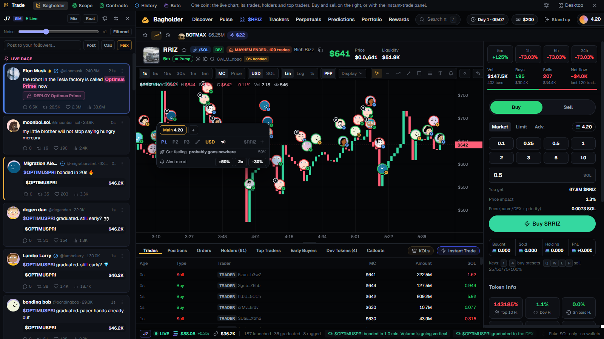
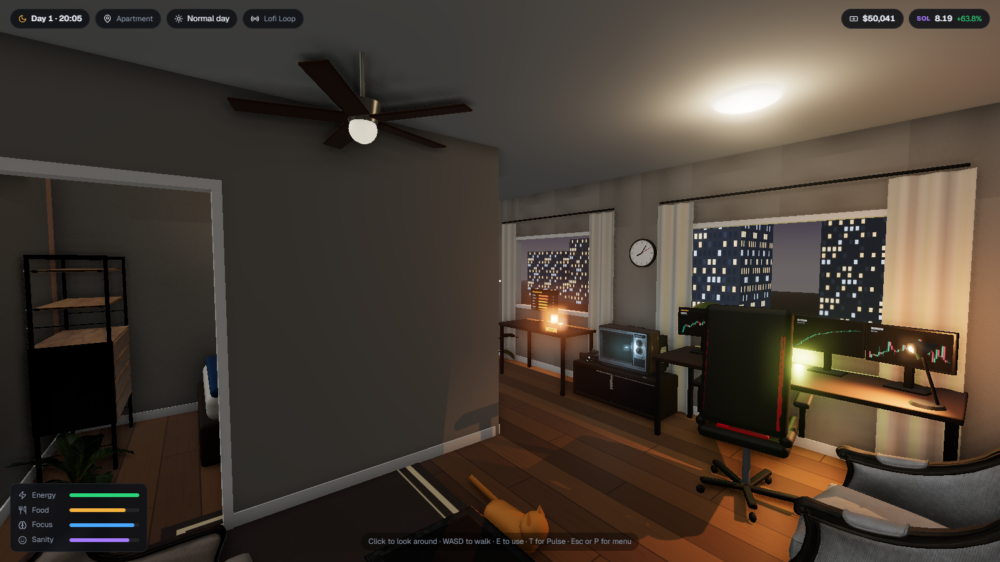
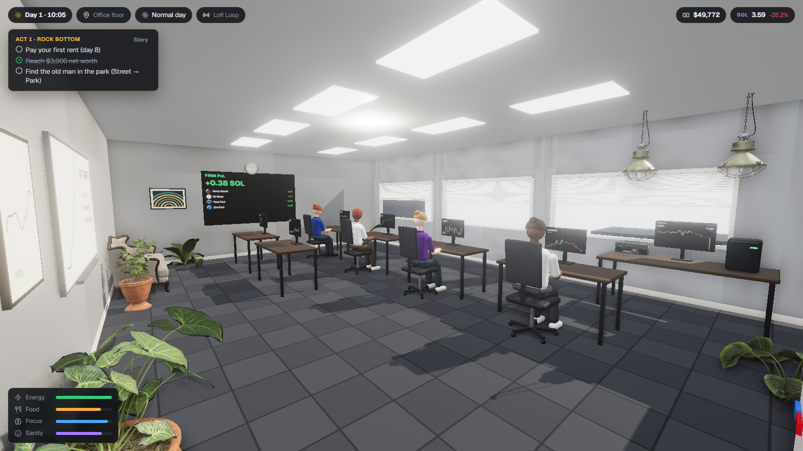
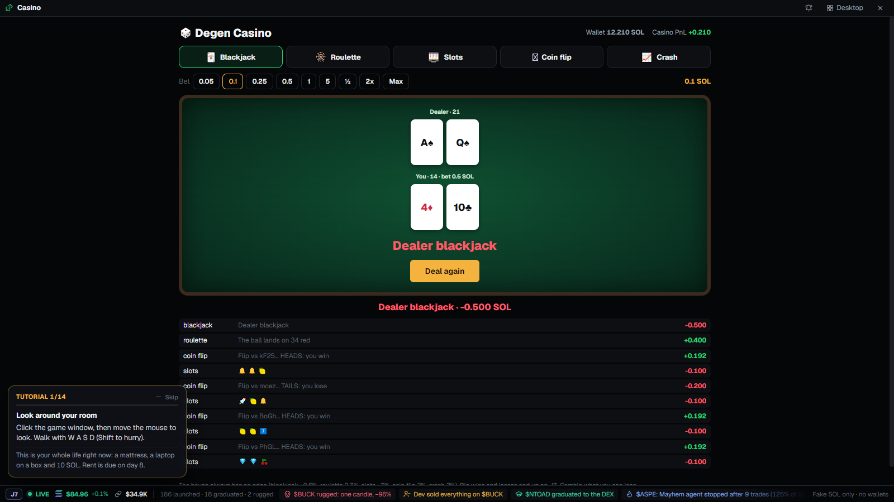
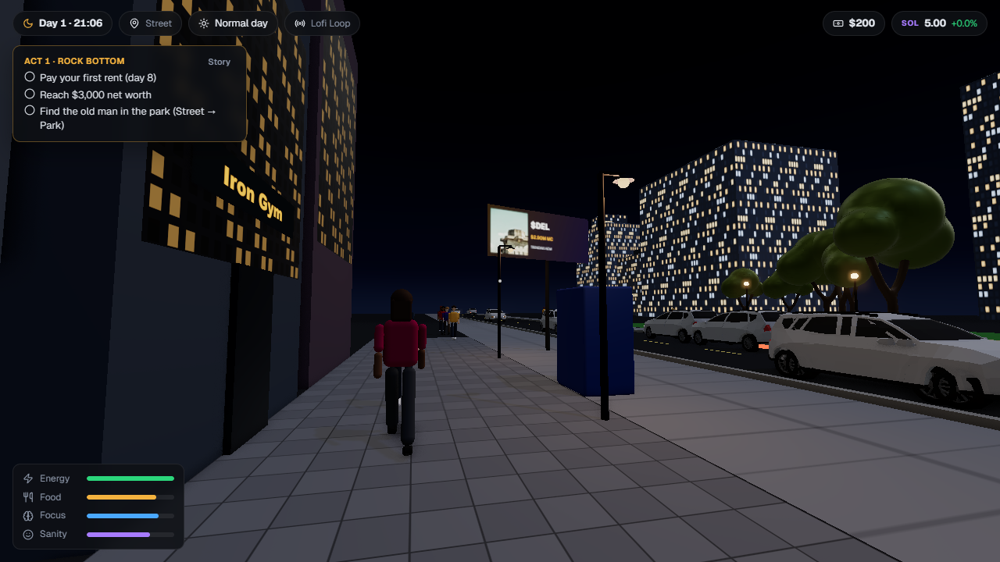

# Bagholder: Degen Life (demo)

A 3D first-person life sim about memecoin trading. You start broke in a bedroom with a laptop and a few fake SOL. Trade launches, chase runners, dodge rugs, pay rent, and try not to become the bagholder.

**Fake money only.** No wallets, no chains, no real money. Every coin, trader and chart in the game is simulated.

## Download and play (Windows)
1. Go to the [Releases](../../releases/latest) page and download `Degen-Life-Windows.zip`.
2. Unzip it anywhere.
3. Open the `Degen Life` folder and run `Degen Life.exe`.

Windows may warn that the app is from an unknown publisher (it isn't code-signed): click **More info → Run anyway**. Saves go to `%APPDATA%\Degen Life\saves`.

## Controls
- **Walking:** click to look around. **WASD** to walk, **Shift** to hurry, **C** to crouch, **E** to use things, **T** for Pulse, **Tab** for your phone, **Esc** or **P** for the menu.
- **At the computer:** the trading terminal opens. **Esc** goes back to Pulse, then the desktop; **Stand up** gets you out of the chair.
- **Terminal keys:** `1`–`4` buy presets · `Q` `W` `E` `R` sell 25/50/75/100%.
- **Chart:** scroll to zoom, drag to pan, drag the price axis to stretch, double-click to jump back to live.

## What's in the demo
- **The trading terminal:** live new pairs / final stretch / migrated feed, a 1s chart with KOL bubbles and drawing tools, instant trade, perps, a casino, callouts and a J7-style tweet feed where big accounts start coin races.
- **The market:** every coin secretly gets a fate (dead on arrival, rug, pump and dump, whale play or runner), with whales, snipers, KOL callers, copycat coins and market days that change the mood.
- **Life:** energy, food, focus, sanity, rent and bills, a 10-act story, and moving up from a bedroom to an apartment, an office floor and a tower.

| | |
|---|---|
|  |  |
|  |  |

## Credits
Music, sounds, models, textures and images are CC0 or free-licensed. See [CREDITS.md](CREDITS.md).

The game's source code is not public.
